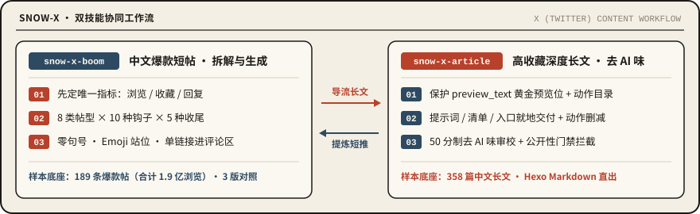

<div align="center">

[](#项目介绍)

</div>

<h1 align="center">snow-x</h1>

<div align="center">

[](#) [](#协议) [](#技能一览) [-b8412c?style=flat-square&labelColor=2e4a62)](#项目介绍)<br>
[](#安装与接入) [](#设计架构) [](#功能详解) [](https://x.com/xueyu1125)

</div>

<p align="center"><b>把零散素材、实操笔记和热点，变成有数据支撑的 X 中文爆款短帖与高收藏长文。</b></p>

<div align="center">



</div>

## 项目介绍

`snow-x` 是一套面向 X（Twitter）中文内容创作与账号运营的开源 Agent Skill 套件，包含两个独立但可配合使用的技能：[`snow-x-boom`](snow-x-boom/) 负责中文短帖的爆款生成与反向拆解，[`snow-x-article`](snow-x-article/) 负责长文的写作、改写、去 AI 味与 Hexo 兼容 Markdown 输出。

两个技能均采用纯指令与结构化参考库封装，不依赖 Python、Node 运行时，也不内置或额外调用大模型 API。装进 Claude Code、Codex、Antigravity 或 Cursor 后，直接由当前会话的模型本地执行。

## 为何开发 snow-x

直接让大模型写推文或 X 长文，通常会出现两类固定毛病：

- 写短帖时贪大求全，一条内容既想要浏览又想要收藏和评论，正文塞满书面句号、情绪 emoji、Markdown 加粗和外链，前 140 个汉字放不下核心数字和钩子，发出去后折叠截断、传播乏力。
- 写长文时开篇先寒暄半页，把 X 长文卡片 `preview_text` 仅有的前 100 多字预览位浪费在客套话里；正文写成一句一行的碎推文体，缺少可复制带走的提示词与清单，结尾还可能漏出本地盘符路径或「值得注意的是」「赋能」「闭环」等 AI 套话。

`snow-x` 把 189 条短帖爆款样本（合计 1.9 亿浏览）和 358 篇中文 X 长文的实测统计拆成可执行规则：短帖按「先定目标数据 → 选帖型 → 组合钩子 → 硬规则排雷」出稿，长文按「写前四格决策 → 保护 `preview_text` 与动作目录 → 动作连贯性删减 → 50 分制去 AI 味审校与公开性门禁」交付。

## 功能特性

- 目标先行写作：短帖第一步先锁定唯一数据指标（浏览、收藏或回复），再反推帖型、开头钩子与结尾动作，避免自相矛盾
- 实证公式库：沉淀 8 种爆款短帖类型、10 种开头公式、5 种结尾公式和 34 条可套用句式，按需加载，不一次占满上下文
- 三版对照交付：短帖默认输出 3 个主开头公式两两不同的版本（附单链接评论区自回复与发布建议），方便直接挑选测试
- 爆款反向拆解：输入任意爆款推文文本或链接，反向拆出所属类型、目标数据、开头与结尾公式，以及可套用到自身领域的槽位模板
- `preview_text` 窗口保护：长文禁止正文写 H1 和开头寒暄，用三段式导语直占 X 长文卡片黄金预览区，并在 `<!-- more -->` 前放置 8–18 字短促动作目录
- 就地交付与动作剪枝：提示词代码块、直达链接和核对清单直接贴在对应步骤正下方，并逐句剔除不影响下一步操作的废话
- 去 AI 味与公开性门禁：长文交付前必须通过 5 维度 `/50` 分制去 AI 味审校，并逐行拦截 `D:/`、`C:\` 等本地路径和私有文件名
- 短长双闭环：长文完成后在聊天区额外输出标题备选和可压缩短推版本，直接无缝交给 `snow-x-boom` 做时间线引流

## 技能一览

| 技能 | 定位 | 样本底座 | 核心触发词 | 核心产出 | 依赖特点 |
| ---- | ---- | -------- | ---------- | -------- | -------- |
| [`snow-x-boom`](snow-x-boom/) | 中文短帖爆款生成与反向拆解 | 189 条爆款帖（合计 1.9 亿浏览） | `写推文`、`改推文`、`爆款开头`、`拆解爆款`、`原创者收益` | 3 版不同主钩子的可直接粘贴短帖 + 发布建议，或结构化拆解模板 | 纯文档，按需读取 5 份参考库；读链接时可选配网页读取工具 |
| [`snow-x-article`](snow-x-article/) | 深度长文写作、改写与去 AI 味 | 358 篇中文 X 长文（收藏率中位 0.90%） | `X长文`、`推特长文`、`写长文`、`改长文`、`重写文章` | 单一规范 Hexo Markdown 成稿 + 聊天区标题备选与短推摘要 | 完全自包含单文件 Skill，零外部依赖 |

按运营目的选择技能与工作模式：

| 你的需求 | 调用技能 | 对应模式 / 策略 |
| -------- | -------- | --------------- |
| 有视频或成品截图，想冲时间线播放量 | `snow-x-boom` | 写作模式 → 类型 1（一句话 + 作品）或类型 2（续集） |
| 整理了一批工具、Prompt 或免费资源，想冲收藏涨粉 | `snow-x-boom` | 写作模式 → 类型 3（清单合集，限 6 项）或类型 4（免费福利） |
| 刚刷到外网热点或想做话题互动拿回复 | `snow-x-boom` | 写作模式 → 类型 6（热点搬运）或类型 8（二选一提问 / 搞笑） |
| 看到一条高赞推文，想摸清套路并套到自己赛道 | `snow-x-boom` | 拆解模式（提取帖型、公式、槽位模板并生成示例） |
| 把零散笔记、实操流程写成结构完整的 X 长文 | `snow-x-article` | 新建长文流程（大纲确认 → 分章撰写 → 去 AI 味 → 门禁交付） |
| 把旧版长文、串推草稿改成无 AI 腔的规范格式 | `snow-x-article` | 编辑改写流程（自动迁移旧格式 → 删减废话 → 50 分制审校） |

## 功能详解

<details>
<summary><b>snow-x-boom：七步短帖写作工作流与反向拆解</b></summary>

1. **Step 1 定目标数据**：在「浏览（中位 79 万，收藏率仅 0.24%）」「收藏/涨粉（收藏率 1%–1.9%）」「回复（回复率平均 2.5 倍以上）」中锁定唯一目标；未指定时按素材自动推断或反问确认。
2. **Step 2 选帖子类型**：读取 [references/post-types.md](snow-x-boom/references/post-types.md)，从 8 类中选 1 种主类型（一句话 + 作品、我用 X 做了 Y 续集、清单合集、免费福利、一句干货、外网热点搬运、推荐别人的内容、提问和搞笑）。
3. **Step 3 写开头第一句**：读取 [references/hooks.md](snow-x-boom/references/hooks.md)，从 10 种开头公式中组合 1–3 种（如数字反差 + 时间紧迫），首行必须带**读者可感知的收益、成本或效果数字**（不用源码行数或体积等内部指标）、工具名或画面，并按帖型决定行首气氛 / 数据 emoji。
4. **Step 4 写中间**：分步、分项与清单统一使用 `1️⃣` `2️⃣` `3️⃣` 序号且不叠加其他 emoji；清单合集严格控制在 6 项以内，只写「能帮你做什么」（盘点 `/r/xxx` 等固定前缀社区时直接用原生简写）。
5. **Step 5 写结尾最后一句**：读取 [references/endings.md](snow-x-boom/references/endings.md)，让结尾与 Step 1 目标一致——单链接放进评论区自回复并用 `👇👇👇` 引导，多链接跟在清单各项正文内，「建议收藏」整条仅出现一次。
6. **Step 6 反模式自检**：拦截编造翻倍数字、假新闻反转、干货夹带软广、单图配「我去」、AI 腔排比，并复查正文零句号、无 Markdown 语法、前 140 汉字完整露出钩子与数字。
7. **Step 7 输出交付**：默认给出主开头公式两两不同的版本 A / B / C 及发布建议；推文正文与评论区自回复一律用 ```` ```text ```` 代码块包裹且段间、序号项间强制空行，并按「配图与拼图规范」控制引用推（Quote Tweet）配图与 1080p 拼图；拆解模式下则输出「帖子类型 / 开头公式 / 中间结构 / 结尾公式 / 可复用模板 / 套用示例」。

</details>

<details>
<summary><b>snow-x-article：三阶段长文工作流与 Hexo 标准格式</b></summary>

1. **写前四格决策**：动笔前先锁定交付类型（清单合集 1.24% / 实操教程 0.95% / 观点拆解 0.75%）、必须附带的可复用材料（提示词 / 清单 / 模板 / 入口）、8–18 字动作型目录条目写法，以及避免空洞「保姆级」与感叹号的标题纪律。
2. **唯一规范格式**：
   - YAML front-matter 包含 `title`、`date: YYYY-MM-DD 12:00:00` 与 `tags: [a, b, c]`；正文禁用 H1 和包装标题。
   - 开篇 3 段导语直占 X 卡片 `preview_text` 窗口（核心钩子 → 4–7 个具体实操卡点 → 亲测背书与附件预告）。
   - ≥ 4 章或 ≥ 2,000 字时，在 `<!-- more -->` 正上方输出粗体 `**目录**` 有序列表，与正文 `## 01｜`…`## 0N｜` 编号章节一一对应。
   - 提示词代码块、直达链接与界面截图就地贴在对应步骤下方；末尾按需保留 `---` 后的 `## 参考来源`。
3. **三阶段工作流**：
   - **Stage 1（决策、调研与保留人味）**：核实公开事实，保留第一人称真实细节与口语节奏；遇宽泛主题、粗略笔记或超 1,500 字新稿先走大纲确认检查点。
   - **Stage 2（动作删减与去 AI 味）**：逐句执行动作连贯性删减，清除破折号泛滥、三段式套话和「不是…而是…」句式，从 Directness、Rhythm、Trust、Human voice、Concision 五个维度打出 `/50` 分（≥ 45 通过，40–44 润色，< 40 重写）。
   - **Stage 3（终检与文件隔离）**：落盘只写纯净成稿，工作副产物（3–5 个 `标题备选` 与 `可压缩成短推的版本`）只在聊天回复中输出。

</details>

<details>
<summary><b>双技能联动：长文沉淀 + 短帖导流完整闭环</b></summary>

推荐的日常内容生产链路：

1. **热点 / 素材侦察与破冰**：用 `snow-x-boom` 拆解同类高互动原帖结构，或先发一条短平快测试帖验证话题反馈。
2. **长文沉淀与交付**：用 `snow-x-article` 把跑通的完整方法论、报错排查和可复制提示词整理成 Hexo 规范长文发布到 X Articles 与个人博客，沉淀高收藏与涨粉资产。
3. **短帖反哺导流**：拿着 `snow-x-article` 聊天区产出的「可压缩成短推的版本」，交给 `snow-x-boom` 套用「导向长文」结尾公式（`👇 完整教程在下面的长文`）生成 3 版时间线引流短帖，把公域浏览导进长文。

</details>

<details>
<summary><b>质量与安全门禁：反模式自检与公开性检查</b></summary>

- **短帖真实性与合规自检**：禁止编造收益截图或夸大浏览翻倍数字（搞钱类关键词必须有用户提供的真实数据背书）；痛点类关键词仅限素材本身涉及或亲身经历；搬运外网热点必须用自己的话重写、附带观点并在评论区自回复注明原帖作者 `@` 与链接。
- **长文双检查点（Checkpoints）**：新建超过 1,500 字或结构未明的长文前触发 Checkpoint 1（大纲确认）；覆盖已有 Markdown 文件前触发 Checkpoint 2（先完整读取原文件，保护用户手写段落与已插入截图，老旧格式自动迁移为规范格式）。
- **公开性门禁（Publicness Gate）**：成稿落盘前逐行扫描，禁止出现 `D:/`、`G:/`、`C:\` 等本地盘符路径、仅本地可见的日志笔记文件名或未公开内部来源；按「映射为公开链接 → 无公开链接则删除」顺序清理，缺失配图自动转为 `<!-- TODO: 配图缺失 ... -->` 注释，避免死链。

</details>

## 安装与接入

### 一句话接入

把下面这段话直接发给 Claude Code、Codex、Antigravity 或 Cursor，让 Agent 自动克隆仓库并安装到本机 Skills 目录：

> 请帮我安装 GitHub 仓库 https://github.com/Andrew-liu/snow-x 中的 `snow-x-article` 和 `snow-x-boom` 两个 Agent Skill 到当前环境的全局 skills 目录，安装后告诉我存放路径和触发方式。

### Skills CLI 安装

如果你的环境支持 `npx skills`，可以直接执行单行命令安装到全局（或省略 `-s` 一次安装全部）：

```bash
# 安装仓库内全部技能（snow-x-article + snow-x-boom）
npx skills add Andrew-liu/snow-x -g

# 按需单独安装某一个技能
npx skills add Andrew-liu/snow-x -s snow-x-boom -g
npx skills add Andrew-liu/snow-x -s snow-x-article -g
```

### 手动安装

克隆仓库后，将两个技能目录复制或软链接（Windows 可使用目录联接 `mklink /J`）到对应工具的技能目录：

```bash
git clone https://github.com/Andrew-liu/snow-x.git
```

常见客户端全局技能目录位置：

- **Codex / 通用规范**：`~/.agents/skills/`（或 `~/.codex/skills/`）
- **Claude Code**：`~/.claude/skills/`
- **Windows 示例（PowerShell）**：

```powershell
# 克隆后复制两个技能到 Claude Code 与 Codex 全局目录
Copy-Item .\snow-x\snow-x-article "$HOME\.claude\skills\snow-x-article" -Recurse -Force
Copy-Item .\snow-x\snow-x-boom "$HOME\.claude\skills\snow-x-boom" -Recurse -Force
```

### 作为 Skill 使用

安装完成后，在任意会话里直接输入自然语言触发词，或显式调用技能名称即可：

- **短帖爆款（`snow-x-boom`）**：直接说「帮我写一条冲收藏的爆款推文」「拆解这条推为什么爆」，或使用 `/snow-x-boom`、`$snow-x-boom`、`@command://snow-x-boom`。
- **深度长文（`snow-x-article`）**：直接说「根据笔记写一篇 X 长文」「帮我重写这篇文章并去掉 AI 味」，或使用 `/snow-x-article`、`$snow-x-article`、`@command://snow-x-article`。

## 快速体验

安装后可以直接复制以下提示词验证效果：

```text
@command://snow-x-boom 我整理了 5 个最近实测好用的开源终端 AI 工具（附各自 GitHub 地址和适用场景），帮我写 3 个版本冲收藏的中文推文，先按规范输出最容易被收藏的那版结构。
```

```text
@command://snow-x-boom 帮我拆解这条爆款推文的类型、开头公式和结尾公式，并给一个能套用到「AI 编程提效」上的模板：<粘贴原帖内容或链接>
```

```text
@command://snow-x-article 我有一份排查 Docker 部署内存泄漏的零散笔记，帮我先出一版包含「交付类型、核心附件和目录」的大纲，确认后再写成去 AI 味的 Hexo 规范 X 长文。
```

## 设计架构

| 组件 | 设计选型 |
| ---- | -------- |
| 技能入口 | 遵循 Agent Skills 规范，每个技能以独立的 `SKILL.md`（YAML front-matter + 执行规程）作为唯一入口 |
| 上下文管理 | `snow-x-boom` 将 8 类帖型、10 种钩子、5 种收尾、34 条句式与样本数据拆分到 `references/`，按写作阶段按需读取 |
| 短帖输出契约 | 用 ```` ```text ```` 代码块包裹纯文本直贴 X（内部禁用 Markdown 与句号，段间与序号项间强制空行），约束前 140 汉字钩子密度、emoji 占位、单/多链接分发与引用推/拼图配图规范 |
| 长文输出契约 | 标准 Hexo Markdown（YAML front-matter + `**目录**` + `<!-- more -->` + `## 01｜` 章节），工作副产物只走聊天输出 |
| 网页读取（可选） | 拆解或推荐他人 X 帖子时，优先通过 `api.fxtwitter.com` 配合 `r.jina.ai` 获取完整正文、X 长文与 `?name=orig` 高清原图；无网络时直接粘贴文本即可 |

## 数据与边界

- 全部提示词与参考库都在本地由你当前使用的 Agent 执行，本仓库不含任何后端服务、遥测统计或自动发帖脚本。
- 长文公开性门禁会在写入前拦截本地磁盘路径与私有文件名，但最终公开发布前仍请自行核对正文中的账号信息、截图隐私与外部引用链接。
- 短帖爆款规则严禁无中生有编造收益截图或播放翻倍数字；「月入 / 收益」等关键词必须绑定真实素材数据。
- `snow-x-boom` 与 `snow-x-article` 中的收藏率、浏览中位数来源于公开案例样本（189 条爆款短帖与 358 篇中文长文），仅作创作决策基准，不构成平台算法承诺。
- 本项目与 X Corp.（Twitter）官方无任何关联。

## 项目结构

```text
snow-x/
├── snow-x-article/              # X/Twitter 长文写作、改写与去 AI 味 Skill
│   └── SKILL.md                 # 长文规范、四格决策、三阶段工作流与公开性门禁
├── snow-x-boom/                 # X/Twitter 中文短帖爆款文案与拆解 Skill
│   ├── SKILL.md                 # 七步写作流程、拆解流程、标点/Emoji/链接硬规则与配图拼图规范
│   └── references/              # 按需加载的爆款参考库
│       ├── post-types.md        # 8 种爆款帖型、模板与原帖拆解
│       ├── hooks.md             # 10 种开头公式、组合用法与高频爆款词库
│       ├── endings.md           # 5 种结尾公式与目标指标对照表
│       ├── sentence-bank.md     # 34 条可套用的开场/中段/收尾爆款句式
│       └── source-notes.md      # 189 条样本出处、关键统计与反模式清单
├── docs/
│   └── images/                  # README 配图（logo.svg、overview.svg）
├── .gitattributes               # 跨平台换行符规范（MD / SVG 统一 LF）
├── .gitignore                   # 忽略本地输出、草稿、缓存与编辑器配置
├── LICENSE                      # MIT 开源协议
└── README.md                    # 项目说明文档
```

## 参与贡献

欢迎通过 Issues 或 Pull Request 分享新的高转化推文样本拆解、开头/结尾公式补充或长文反模式规则优化；修改技能文档时请保持规则描述简洁可执行，避免引入外部运行依赖。

## 协议

本项目采用 [MIT License](LICENSE) 开源。
